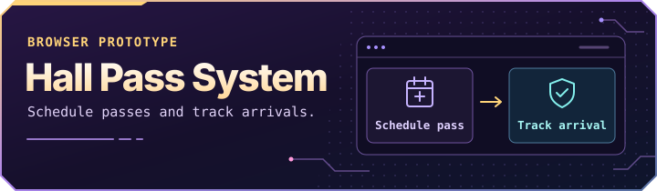
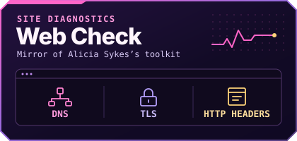
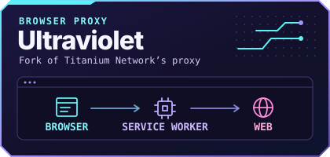

<p align="center">
  
</p>

<p align="center">
  <a href="#my-projects">My projects</a> &nbsp;·&nbsp;
  <a href="#whoami">Who am I?</a> &nbsp;·&nbsp;
  <a href="https://github.com/FyreCalypto#js-contribution-activity-description">GitHub activity</a>
</p>


### My projects

<p align="center">
  <a href="https://github.com/FyreCalypto/hall-pass-system"></a>
</p>

**[Hall Pass System](https://github.com/FyreCalypto/hall-pass-system)** · I built a browser prototype for scheduling passes and checking arrivals, with separate views for staff and students. `JavaScript` `HTML` `CSS`

- **[AdventureGameTest](https://github.com/FyreCalypto/AdventureGameTest)** · My first calculator project in TI-BASIC.
- **[BiologyProject](https://github.com/FyreCalypto/BiologyProject)** · A single-page site I made to explain cellular metabolism and signaling.


### whoami

```console
$ whoami
ipjustice
$ cat interests.txt
packet analysis · defensive security · web security
```

I’m curious about what happens after you hit Enter: where packets go, what gets encrypted, and what the logs can tell you when something breaks.

<p align="center">
  
</p>

<details>
<summary><strong>🌑 Open the Hatman’s lab</strong></summary>

A fresh HTTPS connection over TCP usually goes like this:

```text
DNS lookup → TCP handshake → TLS handshake → encrypted HTTP
```

Try this Wireshark display filter on a capture from your own device. It shows DNS traffic, TCP packets with the SYN flag set, and traffic recognized as TLS.

```text
dns or tcp.flags.syn == 1 or tls
```

</details>


<details>
<summary><strong>🔬 Forks and mirrors</strong></summary>

<p align="center">
  <a href="https://github.com/FyreCalypto/washpods"></a>
  &nbsp;
  <a href="https://github.com/FyreCalypto/Ultraviolet"></a>
</p>

- **[Web Check mirror](https://github.com/FyreCalypto/washpods)** · Alicia Sykes’s toolkit for inspecting a site’s DNS records, TLS configuration, and HTTP headers.
- **[Ultraviolet fork](https://github.com/FyreCalypto/Ultraviolet)** · Titanium Network’s browser proxy. A look at how a service worker intercepts and forwards requests.

</details>

<p align="center">
  <a href="https://github.com/FyreCalypto#js-contribution-activity-description">Live contribution graph ↗</a> &nbsp;·&nbsp;
  <a href="https://github.com/FyreCalypto?tab=repositories">All repositories ↗</a>
</p>

<p align="center">
  <a href="https://countergithub.w3spaces.com/preview.svg?theme=rule34"></a><br>
  <sub>Badge requests</sub>
</p>
