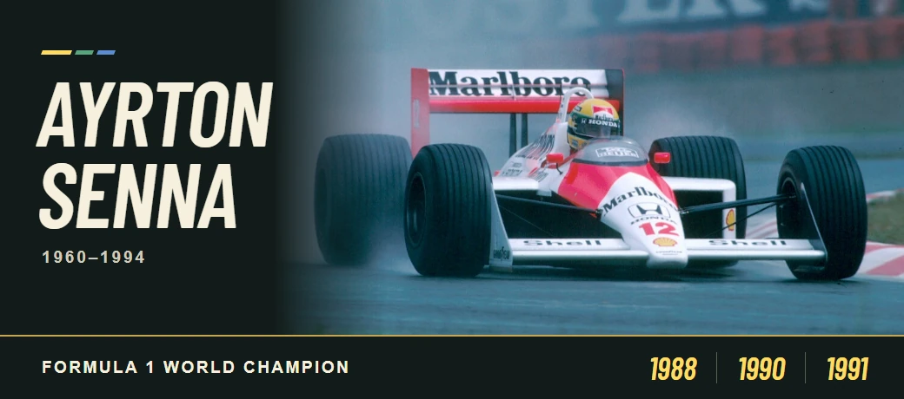

<p align="center">
  
</p>

<p align="center">
  <a href="#my-projects">My projects</a> &nbsp;·&nbsp;
  <a href="#credentials">Credentials</a> &nbsp;·&nbsp;
  <a href="#whoami">Who am I?</a> &nbsp;·&nbsp;
  <a href="https://github.com/FyreCalypto#js-contribution-activity-description">GitHub activity</a>
</p>


### My projects

<p align="center">
  <a href="https://github.com/FyreCalypto/hall-pass-system"></a>
</p>

**[Hall Pass System](https://github.com/FyreCalypto/hall-pass-system)** · I built a browser prototype for scheduling passes and checking arrivals, with separate views for staff and students. `JavaScript` `HTML` `CSS`

- **[AdventureGameTest](https://github.com/FyreCalypto/AdventureGameTest)** · My first calculator project in TI-BASIC.
- **[BiologyProject](https://github.com/FyreCalypto/BiologyProject)** · A single-page site I made to explain cellular metabolism and signaling.


### Credentials

<p align="center">
  <strong>Cisco Certified Support Technician</strong><br>
  <a href="https://www.credly.com/badges/29ce30b1-e542-4637-83f8-396c6ab2affa/public_url"></a>
  <a href="https://www.credly.com/badges/9b95825d-45b1-4c9a-98e2-7ccad62a5459/public_url"></a>
  <a href="https://www.credly.com/badges/8c6ee974-5398-489e-9d5f-ed4a97c759bf/public_url"></a>
  <br><sub>Cybersecurity · Networking · IT Support</sub>
</p>

<p align="center">
  <strong>Certiport</strong><br>
  <a href="https://www.credly.com/badges/738455a8-f6a3-4a26-b997-eae610d08c6a/public_url"></a>
  <a href="https://www.credly.com/badges/140306e2-b06c-498e-b088-996a5ed90e71/public_url"></a>
  <br><sub>Network Security Support Technician · IT Technical Support Specialist</sub>
</p>

<p align="center">
  <a href="https://www.credly.com/users/dragos-todoran/badges">View all 13 badges on Credly ↗</a>
</p>


### whoami

```console
$ whoami
ipjustice
$ cat interests.txt
packet analysis · defensive security · web security
```

I’m curious about what happens after you hit Enter: where packets go, what gets encrypted, and what the logs can tell you when something breaks.

<p align="center">
  
</p>

<details>
<summary><strong>🌑 Open the Hatman’s lab</strong></summary>

A fresh HTTPS connection over TCP usually goes like this:

```text
DNS lookup → TCP handshake → TLS handshake → encrypted HTTP
```

Try this Wireshark display filter on a capture from your own device. It shows DNS traffic, TCP packets with the SYN flag set, and traffic recognized as TLS.

```text
dns or tcp.flags.syn == 1 or tls
```

</details>


<details>
<summary><strong>🔬 Forks and mirrors</strong></summary>

<p align="center">
  <a href="https://github.com/FyreCalypto/washpods"></a>
  &nbsp;
  <a href="https://github.com/FyreCalypto/Ultraviolet"></a>
</p>

- **[Web Check mirror](https://github.com/FyreCalypto/washpods)** · Alicia Sykes’s toolkit for inspecting a site’s DNS records, TLS configuration, and HTTP headers.
- **[Ultraviolet fork](https://github.com/FyreCalypto/Ultraviolet)** · Titanium Network’s browser proxy. A look at how a service worker intercepts and forwards requests.

</details>

<p align="center">
  <a href="https://github.com/FyreCalypto#js-contribution-activity-description">Live contribution graph ↗</a> &nbsp;·&nbsp;
  <a href="https://github.com/FyreCalypto?tab=repositories">All repositories ↗</a>
</p>

<p align="center">
  <a href="https://countergithub.w3spaces.com/preview.svg?theme=rule34"></a>
</p>

---

### In memory of Ayrton Senna

<p align="center">
  <a href="https://commons.wikimedia.org/wiki/File:Senna_1988.jpg"></a>
</p>

<p align="center">
  <strong>21 March 1960 – 1 May 1994</strong><br>
  Three-time Formula 1 world champion · 1988, 1990, 1991
</p>

<p align="center">
  At Interlagos in 1991, Senna won his home Grand Prix for the first time, driving the closing laps in sixth gear.
</p>

<p align="center">
  <a href="https://www.formula1.com/en/information/drivers-hall-of-fame-ayrton-senna.FLD7ZtO0nUn7JzLEn5rOJ">Formula 1 Hall of Fame</a> &nbsp;·&nbsp;
  <a href="https://institutoayrtonsenna.org.br/en/about-us/our-history/">Instituto Ayrton Senna</a><br>
  <sub>Photo by Instituto Ayrton Senna, cropped by Karpouzi and adapted for this tribute · <a href="https://commons.wikimedia.org/wiki/File:Senna_1988.jpg">Original image</a> · <a href="https://creativecommons.org/licenses/by/2.0/">CC BY 2.0</a></sub>
</p>
