<p align="center">
  
</p>

<p align="center">
  <a href="#-projects">Projects</a> ·
  <a href="https://github.com/FyreCalypto?tab=repositories">All repos</a> ·
  <a href="https://github.com/FyreCalypto#contribution-activity">Activity</a>
</p>

### 🔥 `whoami`

```js
const fyreCalypto = {
  experiments: ["browser games", "small web apps"],
  tools: ["JavaScript", "HTML", "CSS"],
  motto: "Open a tab and see what happens."
};
```

### 🛠️ Stack


### 🎮 Projects

| Project | What you'll find |
| :--- | :--- |
| [Hall Pass System](https://github.com/FyreCalypto/hall-pass-system) | A browser prototype for scheduling passes and checking arrivals. |
| [GameNas](https://github.com/FyreCalypto/thepizzaedition.github.io) | A collection of browser games, from 2048 to Run 3. |
| [Henry Stickmin: Bank](https://github.com/FyreCalypto/henry-stickman-bank) · [Prison](https://github.com/FyreCalypto/henry-stickman-prison) | Browser builds of *Breaking the Bank* and *Escaping the Prison*. |

### ⚡ GitHub activity

[Contribution history](https://github.com/FyreCalypto#contribution-activity) · [Pull requests](https://github.com/pulls?q=is%3Apr+author%3AFyreCalypto) · [Starred repos](https://github.com/FyreCalypto?tab=stars)
