<p align="center">
  
</p>

<p align="center">
  <a href="#focus">Focus</a> &nbsp;·&nbsp;
  <a href="#repositories">Repositories</a> &nbsp;·&nbsp;
  <a href="https://github.com/FyreCalypto#contribution-activity">GitHub activity</a>
</p>

### Focus

I’m interested in how traffic moves, where trust is established, and what defenders can learn from packets and logs.

- **Networking** · DNS, routing, TCP/IP, and packet analysis
- **Defensive security** · TLS, firewall rules, and network monitoring
- **Web security** · HTTP headers, browser proxies, and access controls

<details>
<summary><strong>Trace an HTTPS request</strong></summary>

For a fresh HTTPS connection over TCP, the browser resolves the host through **DNS** if needed, opens a **TCP** connection, negotiates **TLS**, and sends the **HTTP** request through the encrypted connection.

In Wireshark, this display filter shows DNS, packets with the TCP SYN flag, and traffic Wireshark recognizes as TLS:

```text
dns or tcp.flags.syn == 1 or tls
```

</details>

### Repositories

| Repository | What to look at |
| :--- | :--- |
| [Web Check mirror](https://github.com/FyreCalypto/washpods) | Alicia Sykes’s website diagnostics toolkit, with checks for DNS records, TLS, and HTTP response headers. |
| [Ultraviolet fork](https://github.com/FyreCalypto/Ultraviolet) | Titanium Network’s browser proxy. Its service worker shows how requests are intercepted and forwarded. |
| [Hall Pass System](https://github.com/FyreCalypto/hall-pass-system) | A browser prototype for scheduling passes and tracking arrivals, with views for different user roles. |

[Browse all repositories ↗](https://github.com/FyreCalypto?tab=repositories)
